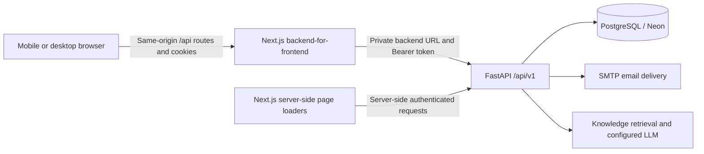

# UniCircle API Design

Status: implementation-aligned reference, reviewed on **25 October 2026**.

This document describes the API currently implemented in the repository, not a
proposal for new endpoints. It covers authentication, profile management,
directory, campus explorer, clubs/events, membership recruitment, resources/chat,
transport, forum, news, notifications, the campus assistant, and App Admin APIs.

## 1. Sources of truth and scope

The reference baseline is the **98 method/path operations** exposed by the current
FastAPI OpenAPI schema: 97 under `/api/v1`, plus `/health`.

- [Project context](../../UniCircle_AI_Project_Context.md) and
  [implementation plan](../../UniCircle_Feature_Wise_Implementation_TODO.md): product requirements.
- [API router](../../backend/app/api/router.py): registered feature routers.
- [Feature modules](../../backend/app/modules): request validators, response
  serializers, authorization checks, and transaction behavior.
- [Shared response schemas](../../backend/app/api/schemas.py) and
  [error handlers](../../backend/app/core/errors.py): runtime envelope contracts.
- [Next.js API handlers](../../frontend/src/app/api): browser-facing contracts.
- [ERD](ERD.md), [HLD](HLD.md), [LLD](LLD.md), and
  [sequence diagrams](Sequence_Diagram.md): related architecture and workflows.

Where an older design lists a proposed route differently, the implemented router
and this implementation-aligned catalogue take precedence for integration.
Runtime behavior must still be verified with tests; this document does not claim
that a real email was delivered or a production business transaction was tested.

## 2. Architecture and addressing



| Interface | Address | Intended caller |
| --- | --- | --- |
| Backend API | `http://127.0.0.1:8000/api/v1` in local development | Trusted server-side adapters and backend development tools |
| Backend liveness | `http://127.0.0.1:8000/health` | Local/container health checks |
| Browser API | Same-origin `/api/...` | Frontend components through typed service adapters |
| OpenAPI schema | Backend `/api/v1/openapi.json` | Developers and contract tooling |
| Interactive documentation | Backend `/docs` and `/redoc` | Developers, when the backend is reachable |

Production uses the configured private backend service binding. Do not assume
that the public frontend origin exposes `/api/v1`, `/docs`, or `/redoc` directly.
The public Home page is static frontend content; it has no Home CRUD API.

### 2.1 Browser-to-backend mapping

These are adapters, not a second unrestricted backend API. Each gateway has an
explicit method/path allowlist; a backend endpoint existing does not imply that
the corresponding browser gateway exposes it.

| Browser route | Backend target / behavior |
| --- | --- |
| `/api/auth/{action}` | Allowlisted `/api/v1/auth/{action}`; handles session and recovery cookies |
| `PATCH /api/profile` | `PATCH /api/v1/users/me` |
| `GET /api/directory` | `GET /api/v1/departments` |
| `GET /api/campus-explorer` | Combines `/api/v1/campus/map` and `/api/v1/campus/locations` into `data.map` and `data.locations` |
| `/api/club-events/{path}` | Allowlisted club/event, club-request, membership, and notification operations |
| `/api/resource-sharing/{path}` | Allowlisted resource discovery, request, and conversation operations |
| `/api/transport/{path}` | Allowlisted user transport and App Admin transport operations |
| `/api/forum/{path}` | Allowlisted forum and App Admin moderation operations |
| `/api/news/{path}` | Allowlisted published-news and App Admin news operations |
| `POST /api/assistant/ask` | `POST /api/v1/assistant/ask` |
| `GET /api/health` | Checks backend liveness and returns frontend release revision metadata |

Some detail pages fetch backend data through server-side adapters rather than a
matching public BFF route. `/api/health` checks backend reachability, not database
readiness or SMTP delivery.

## 3. Authentication and authorization

### 3.1 Access notation used in the catalogue

| Code | Meaning |
| --- | --- |
| P | Public endpoint; validation/rate limits may still apply |
| T | Live authenticated, active, verified account; the shared dependency also accepts App Admin unless the feature excludes it |
| G | Verified General User: `student`, `teacher`, or `staff`; App Admin excluded |
| S | Verified student account |
| C | Verified student mapped as an admin of the corresponding club |
| A | Verified App Admin account |
| O | Owner/participant of the resource named in the route; combined with an account requirement |

Club Admin is a many-to-many student-to-club assignment, not a global login role.
Being an App Admin does **not** automatically satisfy C. Event registration
inspection/payment review explicitly accepts either C or A.

### 3.2 Session boundary

1. Backend protected routes require `Authorization: Bearer <access-token>`.
2. The backend validates the JWT and its persisted, unrevoked session, then checks
   the current account's active/verified state and relevant object permission.
3. Normal browser code never reads or stores the JWT. The BFF puts it in the
   host-only `unicircle_session` cookie: HttpOnly, SameSite=Lax, Secure in production.
4. Authenticated BFF mutations require the expected Origin and an
   `x-csrf-token` header matching the readable `unicircle_csrf` cookie. Public
   authentication POSTs check same origin; logout also requires session/CSRF.
5. User IDs for ownership come from the validated session, not a submitted
   author/requester ID. Frontend navigation visibility is not authorization.

The OpenAPI security scheme is named `OAuth2PasswordBearer`, but the implemented
login endpoint accepts JSON `identifier`/`password`, not an OAuth form grant, and
returns the UniCircle response envelope. A generic Swagger OAuth password-form
submission is therefore not the login contract.

### 3.3 Passwords, OTPs, and configuration

- Public registration accepts `@cuet.ac.bd` and `@student.cuet.ac.bd` only.
- Passwords require at least eight characters, uppercase, lowercase, and a digit;
  the backend also caps their UTF-8 encoding at 1,024 bytes. Only hashes are stored.
- OTP entry follows **Create account during sign-up**, not normal sign-in.
- Defaults: registration/recovery codes expire after ten minutes, resends have a
  60-second cooldown, and a code permits five incorrect attempts. Deployment
  configuration can change these values within validated bounds.
- Authentication also has durable identity/network throttling. Current defaults
  allow ten identity attempts and 500 network attempts per action per 15 minutes.
- JWT lifetime defaults to 30 minutes. Logout revokes its live session.
- Secrets, SMTP credentials, OTPs, access tokens, and payment identifiers must not
  appear in documentation examples copied from real records, logs, or Git.

## 4. Common contract conventions

### 4.1 JSON and field naming

Requests with bodies use `Content-Type: application/json`. Successful responses
normally use an envelope:

```json
{
  "data": {
    "id": "11111111-1111-4111-8111-111111111111"
  }
}
```

`data` may be an object, array, or documented `null`. A `204` response has no JSON
body; clients must not call `response.json()` unconditionally.

V1 preserves existing names rather than claiming one universal naming scheme:

- Authentication requests use camelCase aliases such as `firstName`, `adminId`,
  `universityId`, `challengeId`, and `resetToken`.
- Most other request models use snake_case, such as `starts_at`, `student_id`,
  `recipient_id`, and `service_date`.
- Many feature responses use camelCase. Directory/campus DTOs retain snake_case.
- Request models reject unknown fields where `extra="forbid"` is configured.
  Preserve these exact wire names in clients.

UUIDs are strings. Club, route, and bus IDs can be slugs; directory/campus IDs are
domain-specific strings, not necessarily UUIDs. Event timestamps require an
explicit timezone. Transport dates use `YYYY-MM-DD`, with separate local schedule
times; responses format `startTime`/`endTime` as `HH:mm`.

Current club/event `fee` values are whole integer **BDT/taka**, as rendered by the
frontend: membership `fee: 200` means Tk 200, not 200 paisa. Do not silently change
currency units based on an older proposed design.

### 4.2 Runtime error envelope

```json
{
  "error": {
    "code": "validation_error",
    "message": "Request validation failed.",
    "details": [
      {
        "field": "body.email",
        "message": "Value error, use a CUET email address",
        "type": "value_error"
      }
    ]
  }
}
```

The example illustrates the shape; exact field messages come from validators.
`details` is optional. Some BFF-local failures return only `error.message`, so
clients must tolerate a missing `code`. FastAPI's automatically generated default
422 schema can differ from this custom runtime validation envelope; the shared
error handler defines the actual error body.

| Status | Meaning / examples |
| --- | --- |
| 200 | Successful read/update/action |
| 201 | Created account, request, event, message, post, or other documented resource |
| 204 | Successful action/deletion without a body |
| 400 | Invalid/expired verification request or code |
| 401 | Missing/invalid credentials or an expired/revoked session |
| 403 | Role/ownership prohibition, Origin rejection, or CSRF failure |
| 404 | Absent or deliberately concealed resource; unsupported BFF path |
| 405 | Unsupported HTTP method |
| 409 | Duplicate record, closed registration/recruitment, or conflicting state transition |
| 413 / 415 | BFF payload too large / JSON content type required |
| 422 | Invalid fields, identifiers, cursors, dates, or domain rules |
| 429 | Authentication/assistant rate or provider usage limit |
| 500 | Sanitized unexpected backend error |
| 502 / 503 | Invalid upstream response or temporarily unavailable dependency |

Do not assume every endpoint advertises every runtime error in OpenAPI, or that a
429 response includes a `Retry-After` header. Use the response contract actually
provided and the relevant UI cooldown.

### 4.3 Pagination and ordering

There is no single pagination shape across all V1 endpoints:

| API | Pagination / response shape |
| --- | --- |
| User discovery, own resource requests, conversations | `data: {items, total, limit, offset}`; default limit 20 |
| App Admin audit logs | Same shape; default limit 50 |
| Forum feed | `data: {currentUser, posts, total, limit, offset}`; default limit 50 |
| Club-creation review queue | `data: {items, total, page, size}`; defaults page 1, size 20 |
| News list | Array in `data`; `limit=50`, `offset=0`, without total metadata |
| Notification inbox | Array in `data`; `limit=100`, `offset=0`, without total metadata |
| Event list | Array in `data`; optional status and `limit=50`, no offset |
| Chat history | `data: {items, hasMore, oldestId, newestId}`; default limit 50; use either `before_id` or `after_id`, never both |

The listed limit/size parameters are bounded to 1–100; offsets are nonnegative.
Chat results are returned in chronological order within each page. Unpaginated
collections, including department lists and some admin queues, remain
unpaginated in this implementation; do not invent cursor parameters for them.

## 5. Backend endpoint catalogue

All paths in sections 5.1–5.11 are relative to `/api/v1`. Access codes are defined
in section 3.1. A blank request body is shown as `—`.

### 5.1 Authentication and account profile

| Method | Path | Access | Request model | Success / effect |
| --- | --- | --- | --- | --- |
| POST | `/auth/register` | P | `RegistrationRequest` | 201; pending account and `{email}` |
| POST | `/auth/verify-otp` | P | `OtpVerificationRequest` | 204; verify sign-up email |
| POST | `/auth/resend-otp` | P | `ResendOtpRequest` | 204; generic acknowledgement |
| POST | `/auth/login` | P | `GeneralLoginRequest` | 200; backend-only token, expiry, user |
| POST | `/auth/admin/login` | P | `AdminLoginRequest` | 200; backend-only App Admin session |
| GET | `/auth/me` | T | — | 200; safe current-user DTO |
| POST | `/auth/logout` | T | — | 204; revoke current session |
| POST | `/auth/forgot-password` | P | `ResendOtpRequest` | 200; generic recovery result and BFF-only ticket |
| POST | `/auth/password-reset/resend-otp` | P | `ResendOtpRequest` | 200; same recovery result; SMTP cooldown applies |
| POST | `/auth/password-reset/verify-otp` | P | `ChallengeVerificationRequest` | 200; BFF-only reset grant and expiry |
| POST | `/auth/reset-password` | P + verified reset grant | `ResetPasswordRequest` | 204; change password and revoke old sessions |
| PATCH | `/users/me` | G + O | `UpdateProfileRequest` | 200; updated General User DTO |

Profile update permits name, username, department, phone, home address, and bio.
It does not permit changing role, CUET email, university ID, or verification state.
General and App Admin user DTOs are a discriminated union: App Admin has `adminId`
and does not fabricate General User email/ID fields.

### 5.2 Department and faculty directory

| Method | Path | Access | Success / result |
| --- | --- | --- | --- |
| GET | `/departments` | T | 200; department array, including faculty DTOs |
| GET | `/departments/{code}` | T | 200; selected department |
| GET | `/departments/{code}/faculty` | T | 200; department's faculty array |
| GET | `/faculty/{entry_id}` | T | 200; faculty listing/contact DTO |
| GET | `/faculty/{entry_id}/profile` | T | 200; in-app faculty profile with source status/fallback |

Faculty contacts may be `null` when unavailable. Profile `source_status` is
`current` or `unavailable`; fetching the source failing must not be mistaken for
the saved faculty record not existing. Education, experience, publications,
research, awards, and related profile entries can be empty arrays.

### 5.3 Campus explorer

| Method | Path | Access | Success / result |
| --- | --- | --- | --- |
| GET | `/campus/map` | T | 200; CUET map center, bounds, boundary, tiles, attribution |
| GET | `/campus/locations` | T | 200; campus location array |
| GET | `/campus/locations/{location_id}` | T | 200; location details and coordinates |

Map coordinate pairs are `[latitude, longitude]`. Location DTOs include category,
description/details, optional image, and source metadata. The UI constrains its
map to the supplied CUET bounds/boundary rather than providing a whole-city map.

### 5.4 Clubs, governance, and membership

| Method | Path | Access | Request model | Success / effect |
| --- | --- | --- | --- | --- |
| GET | `/clubs` | T | — | 200; clubs and viewer membership/admin state |
| GET | `/clubs/administered` | S | — | 200; clubs administered by current student |
| GET | `/clubs/requests/mine` | S + O | — | 200; own creation requests |
| POST | `/clubs/requests` | S | `ClubRequestIn` | 201; pending club-creation request |
| GET | `/admin/club-requests` | A | — | 200; review queue; optional `status`, `page`, `size` |
| POST | `/admin/club-requests/{request_id}/review` | A | `ReviewIn` | 200; approve/reject request |
| GET | `/clubs/{club_id}` | T | — | 200; club details |
| PUT | `/clubs/{club_id}` | C | `ClubUpdateIn` | 200; update club fields |
| GET | `/clubs/{club_id}/members` | T | — | 200; member collection |
| PUT | `/clubs/{club_id}/membership-settings` | C | `MembershipSettingsIn` | 200; recruitment/payment settings |
| POST | `/clubs/{club_id}/membership-requests` | S | `MembershipRequestIn` | 201; paid membership request |
| GET | `/clubs/{club_id}/membership-requests` | C | — | 200; pending requests only |
| POST | `/clubs/{club_id}/membership-requests/{request_id}/approve` | C | — | 200; approve, add membership, notify applicant |
| DELETE | `/clubs/{club_id}/membership-requests/{request_id}` | C | — | 204; remove request |
| DELETE | `/clubs/{club_id}/members/me` | S + O | — | 200; leave club, subject to admin restriction |
| POST | `/clubs/{club_id}/admins` | C | `AdminIn` | 200; map a verified student as club admin |
| DELETE | `/clubs/{club_id}/admins/{target_id}` | C | — | 200; remove admin mapping, retaining at least one |

Business rules:

- Club-creation approval creates the club, its creator's membership, and initial
  Club Admin mapping in one transaction. Repeating the same review decision does
  not create another club; conflicting decisions return 409.
- `ClubRequestIn` contains club fields plus a purpose statement of 20–3,000 characters.
- `AdminIn` accepts exactly one of `user_id` or `student_id`; the target must be
  an active, verified student. Adding an admin also ensures club membership.
- Recruitment settings require both bKash and Nagad numbers when open. The
  membership fee is server-enforced at **Tk 200**; clients cannot choose it.
- A request requires account-matching email/student ID, department, phone,
  motivation, payment method, and transaction ID. Existing members, duplicate
  requests, and closed recruitment are rejected.
- Membership approval and its notification commit together. This is a manual
  payment/recruitment workflow, not automatic bKash/Nagad transaction verification.
- Club Admins must transfer/remove their admin access before leaving; the last
  admin cannot be removed.

### 5.5 Events and registrations

| Method | Path | Access | Request model | Success / effect |
| --- | --- | --- | --- | --- |
| GET | `/clubs/{club_id}/events` | T | — | 200; events belonging to club |
| POST | `/clubs/{club_id}/events` | C | `EventIn` | 201; create event |
| GET | `/events` | T | — | 200; event array; optional `status`, `limit` |
| GET | `/events/{event_id}` | T | — | 200; event details and viewer state |
| PUT | `/events/{event_id}` | C for event's club | `EventIn` | 200; update event |
| DELETE | `/events/{event_id}` | C for event's club | — | 204; delete event |
| PUT | `/events/{event_id}/interest` | S | `InterestIn` | 200; set interested/going/none |
| POST | `/events/{event_id}/registrations` | S | `RegistrationIn` | 201; registration and updated count |
| GET | `/events/{event_id}/registrations` | C or A | — | 200; private participant/payment records |
| PUT | `/events/{event_id}/registrations/{registration_id}/payment` | C or A | `PaymentReviewIn` | 200; verified/rejected payment status |
| GET | `/events/{event_id}/registrations/me` | S + O | — | 200; own registration summary or `null` |

`status` is derived as `upcoming`, `ongoing`, or `finished`. Event administration
does not grant access to unrelated clubs. `registeredCount` counts registrations;
`goingCount` counts Going interest records, a separate concept. Paid registrations
start as `pending_review`; free registrations use `not_required`. A submitted
transaction ID is not proof of payment.

### 5.6 Resource sharing and private chat

| Method | Path | Access | Request model | Success / effect |
| --- | --- | --- | --- | --- |
| GET | `/resource-profile/me` | G + O | — | 200; own discovery/resource profile |
| PATCH | `/resource-profile/me` | G + O | `ResourceProfileIn` | 200; update opt-in profile |
| GET | `/users/discover` | G | — | 200; paginated discovery; `category`, `search`, `limit`, `offset` |
| POST | `/resource-requests` | G | `ResourceRequestIn` | 201; send request |
| GET | `/resource-requests/mine` | G + O | — | 200; `box=sent|received|all`, `limit`, `offset` |
| GET | `/resource-requests/{request_id}` | G + O | — | 200; requester/recipient-only detail |
| POST | `/resource-requests/{request_id}/decision` | G; recipient only | `RequestDecisionIn` | 200; accept/reject |
| GET | `/conversations` | G + O | — | 200; accepted-request conversations |
| GET | `/conversations/{conversation_id}/messages` | G + O | — | 200; bounded cursor-based message history |
| POST | `/conversations/{conversation_id}/messages` | G + O | `MessageIn` | 201; append text message |

Resource categories are `notebook`, `lab-report`, `t-scale`, `bicycle`, and `other`.
Discovery excludes the current user and accounts that are inactive, unverified,
App Admin, or not opted in. Acceptance creates one conversation transactionally;
only the request's two participants can read/send messages. History rejects a
cursor from another conversation. Chat is REST-based, not a WebSocket or an
end-to-end-encrypted messaging protocol.

### 5.7 Transport and App Admin management

| Method | Path | Access | Request model | Success / effect |
| --- | --- | --- | --- | --- |
| GET | `/transport/snapshot` | T | — | 200; snapshot; optional `start_date`, `days=31` |
| GET | `/transport/dates` | T | — | 200; available dates; `days=31` |
| GET | `/transport/schedules` | T | — | 200; trips for required `service_date` |
| GET | `/transport/drivers` | T | — | 200; active drivers with assigned-bus information |
| GET | `/admin/transport` | A | — | 200; routes, buses, drivers, schedule templates |
| POST | `/admin/transport/routes` | A | `RouteIn` | 201; create route |
| PUT | `/admin/transport/routes/{item_id}` | A | `RouteIn` | 200; update route |
| DELETE | `/admin/transport/routes/{item_id}` | A | — | 204; delete route if allowed |
| POST | `/admin/transport/buses` | A | `BusIn` | 201; create bus |
| PUT | `/admin/transport/buses/{item_id}` | A | `BusIn` | 200; update bus |
| DELETE | `/admin/transport/buses/{item_id}` | A | — | 204; delete bus if allowed |
| POST | `/admin/transport/drivers` | A | `DriverIn` | 201; create driver |
| PUT | `/admin/transport/drivers/{item_id}` | A | `DriverIn` | 200; update driver |
| DELETE | `/admin/transport/drivers/{item_id}` | A | — | 204; delete driver if allowed |
| POST | `/admin/transport/schedules` | A | `ScheduleIn` | 201; create schedule template |
| PUT | `/admin/transport/schedules/{item_id}` | A | `ScheduleIn` | 200; update schedule template |
| DELETE | `/admin/transport/schedules/{item_id}` | A | — | 204; delete schedule template |

`days` is bounded to 1–62. User queries reject past starting/service dates using
the backend's current-date calculation. Schedule recurrence is `once`, `daily`,
`weekly`, or `monthly`, optionally ending at `recurrence_until`. The snapshot
expands stored templates into dated trips; V1 does not expose a separate
single-occurrence/whole-series mutation parameter. Bus/route item IDs are strings;
driver/schedule item IDs are UUIDs. Deletion/reference and assignment rules are
enforced in the transport router; do not assume a referenced record can be deleted.

### 5.8 Community discussion and moderation

| Method | Path | Access | Request model | Success / effect |
| --- | --- | --- | --- | --- |
| GET | `/forum/posts` | G | — | 200; feed plus current user and pagination |
| POST | `/forum/posts` | G | `PostIn` | 201; text post |
| GET | `/forum/posts/{post_id}` | G | — | 200; active post |
| GET | `/forum/posts/{post_id}/comments` | G | — | 200; comment array |
| POST | `/forum/posts/{post_id}/comments` | G | `CommentIn` | 201; comment |
| POST | `/forum/posts/{post_id}/reports` | G | `ReportIn` | 201; report once per user/post |
| GET | `/admin/forum/reports` | A | — | 200; optional `status=open|resolved|post-removed` |
| GET | `/admin/forum/reports/{report_id}` | A | — | 200; private report detail |
| PUT | `/admin/forum/reports/{report_id}` | A | `ModerationIn` | 200; resolve report or soft-remove post |

Post/comment bodies are text only. Removed posts are hidden from normal reads.
Post text is 1–1,200 characters, comments 1–600, and report reasons 3–500, with
blank content rejected. Normal users cannot call App Admin moderation operations.

### 5.9 Campus news and announcements

| Method | Path | Access | Request model | Success / effect |
| --- | --- | --- | --- | --- |
| GET | `/news` | T | — | 200; published items; `limit`, `offset` |
| GET | `/news/{item_id}` | T | — | 200; published detail only |
| GET | `/admin/news` | A | — | 200; all items, including drafts |
| POST | `/admin/news` | A | `NewsItemIn` | 201; create draft/published item |
| PUT | `/admin/news/{item_id}` | A | `NewsItemIn` | 200; edit item |
| DELETE | `/admin/news/{item_id}` | A | — | 204; remove item |
| PUT | `/admin/news/{item_id}/status` | A | `PublishStatusIn` | 200; draft/published transition |

Types are `news`, `update`, and `announcement`. User lists are ordered by
publication time, newest first; requesting a draft through the user detail route
returns 404. Eligible update/announcement publication synchronizes notifications
in the source transaction with deduplication; not every ordinary news item is a
campus-wide announcement.

### 5.10 Notifications

| Method | Path | Access | Request model | Success / effect |
| --- | --- | --- | --- | --- |
| GET | `/notifications/me` | T + O | — | 200; own inbox, `limit`, `offset` |
| PUT | `/notifications/read-all` | T + O | — | 200; `{updated}` count |
| PUT | `/notifications/{notification_id}/read` | T + O | — | 200; `{id, readAt}` |

Inbox items contain `id`, `type`, `title`, `message`, `createdAt`, `isRead`, and
optional `href`. Marking read is owner-scoped and repeat-safe. There is no public
API allowing a user to manufacture notifications for other accounts. Event-state
notices come from the notification worker; membership/news notices originate in
their authorized feature transactions.

### 5.11 Campus assistant and App Admin audit

| Method | Path | Access | Request model | Success / effect |
| --- | --- | --- | --- | --- |
| POST | `/assistant/ask` | T | `AssistantQuestion` | 200; `{answer, status}` |
| GET | `/admin/assistant/knowledge` | A | — | 200; knowledge/index status, not an ingestion mutation |
| GET | `/admin/audit-logs` | A | — | 200; paginated audit records |

Assistant questions are 2–500 characters after whitespace normalization. A normal
response status is `answered` or `not-found`; insufficient relevant knowledge is
a valid 200 response, not a fabricated answer. Sources/citations are kept out of
the user-visible answer payload. Missing model/index/provider dependencies return
safe errors; user/provider rate limits may return 429.

Knowledge status includes source/chunk counts, last crawl time, knowledge mode,
bundled section count, and review-due section keys. Refresh/ingestion remains a
controlled backend CLI workflow, not an exposed arbitrary-URL ingestion endpoint.
Audit filters are optional exact-match `action` and `target_type`, with
`limit=50`, `offset=0`. App Admin audit data is read-only through this API.

### 5.12 Liveness outside the versioned prefix

| Method | Path | Access | Success / result |
| --- | --- | --- | --- |
| GET | `/health` | P | 200; `{data: {status: "ok", service: "unicircle-api"}}` |

This route does not prove database readiness, successful email delivery, or an
available LLM. Framework-generated OpenAPI/docs routes are additional tooling
routes, not business operations counted in the 98-operation catalogue.

## 6. Representative request/response contracts

All names, IDs, passwords, payment numbers, and OTPs below are **fictional
examples**, not seeded credentials, working codes, or payment instructions.
Replace them with authorized values when testing a real workflow.

### 6.1 Sign-up and OTP verification

`POST /api/v1/auth/register` (browser: `POST /api/auth/register`):

```json
{
  "firstName": "Example",
  "lastName": "Student",
  "homeAddress": "CUET Campus, Raozan",
  "username": "api_example",
  "email": "api.example@student.cuet.ac.bd",
  "password": "ExampleOnlyPass123!",
  "role": "student",
  "universityId": "example-student-id"
}
```

Success is `201` with `{"data":{"email":"api.example@student.cuet.ac.bd"}}`.
The UI navigates to `/verify-otp?email=...` on both mobile and desktop; no login
session is created by registration. Verification submits:

```json
{
  "email": "api.example@student.cuet.ac.bd",
  "otp": "123456"
}
```

`POST /api/v1/auth/verify-otp` returns 204 on success, and the user proceeds to
normal login. SMTP failure can leave a pending account; the UI still provides
code entry/resend. Resuming the same pending registration requires matching
account details and the correct password, without replacing its data.

### 6.2 Login and session DTO

```json
{
  "identifier": "api_example",
  "password": "ExampleOnlyPass123!"
}
```

Backend `POST /api/v1/auth/login` returns:

```json
{
  "data": {
    "token": "<server-only-access-token>",
    "expiresAt": "2026-10-25T10:30:00Z",
    "user": {
      "id": "11111111-1111-4111-8111-111111111111",
      "role": "student",
      "firstName": "Example",
      "lastName": "Student",
      "displayName": "Example Student",
      "username": "api_example",
      "email": "api.example@student.cuet.ac.bd",
      "universityId": "example-student-id",
      "homeAddress": "CUET Campus, Raozan",
      "department": "CSE",
      "phone": null,
      "bio": null,
      "memberSince": "2026-10-25T09:00:00Z"
    }
  }
}
```

The browser's `/api/auth/login` response contains only `data.user`; the BFF sets
session/CSRF cookies and strips the token/expiry fields from that JSON response.
Normal sign-in does not add an OTP step. Separate App Admin login uses
`{"adminId":"<provisioned-admin-id>","password":"<admin-password>"}`.

### 6.3 Forgotten password: browser and backend differ

| Step | Browser call/body | Backend call/body | Browser-visible result |
| --- | --- | --- | --- |
| Request code | `POST /api/auth/forgot-password`, `{email}` | `/api/v1/auth/forgot-password`, `{email}` | `{data: {flow: "reset", email, expiresAt}}`; HttpOnly recovery cookie |
| Resend code | `POST /api/auth/password-reset/resend-otp`, `{}` | `/api/v1/auth/password-reset/resend-otp`, email injected from recovery cookie | Same generic result; renewed recovery cookie |
| Verify code | `POST /api/auth/password-reset/verify-otp`, `{otp}` | `/api/v1/auth/password-reset/verify-otp`, `{challengeId, otp}` | `{data: {verified: true}}`; HttpOnly reset-grant cookie |
| Save password | `POST /api/auth/reset-password`, `{password}` | `/api/v1/auth/reset-password`, `{resetToken, password}` | 204; auth/recovery cookies cleared |

Backend recovery results include a signed, purpose-separated `challengeId` ticket;
successful code verification includes `resetToken` and `expiresAt`. Neither
credential is exposed to browser JavaScript by the BFF. A ticket alone cannot
change a password. The reset grant is single-use, hash-stored, and expires after
ten minutes. Code expiry/cooldown/attempt checks remain server-enforced.

Saving a new password revokes all prior sessions and pending challenges in the
same user-locked transaction. The UI returns to `/login?reset=1`; the user signs
in with the new password. Known/unknown/inactive emails receive generic recovery
acknowledgements; invalid, expired, and exhausted recovery codes share a safe
error. Provisioned App Admins have no General User email and do not use this flow.

### 6.4 Club recruitment settings and application

`PUT /api/v1/clubs/{club_id}/membership-settings`:

```json
{
  "recruitment_open": true,
  "bkash_number": "01700000000",
  "nagad_number": "01800000000"
}
```

`POST /api/v1/clubs/{club_id}/membership-requests`:

```json
{
  "applicant_name": "Example Student",
  "email": "api.example@student.cuet.ac.bd",
  "student_id": "example-student-id",
  "department_name": "CSE",
  "phone": "01900000000",
  "motivation": "I want to contribute to collaborative campus software projects.",
  "payment_method": "bkash",
  "transaction_id": "EXAMPLETRX001"
}
```

There is no caller-supplied fee or membership approval flag. The club must be
recruiting and the current student's account email/ID must match the application.

### 6.5 Paid event creation and registration

`POST /api/v1/clubs/{club_id}/events`:

```json
{
  "title": "Example Programming Workshop",
  "category": "Workshop",
  "summary": "An illustrative campus workshop.",
  "location": "CUET CSE Department",
  "starts_at": "2026-11-15T09:00:00+06:00",
  "ends_at": "2026-11-15T12:00:00+06:00",
  "registration_enabled": true,
  "registration_closes_at": "2026-11-14T23:00:00+06:00",
  "is_paid": true,
  "fee": 200,
  "bkash_number": "01700000000"
}
```

`EventIn` requires title, category, summary, location, and start/end timestamps;
the end must follow the start. Paid events require enabled registration, a positive
fee, and a bKash number. Free events require zero fee and no bKash number.

Registration body:

```json
{
  "participant_name": "Example Student",
  "email": "api.example@student.cuet.ac.bd",
  "student_id": "example-student-id",
  "department_name": "CSE",
  "bkash_trx_id": "EXAMPLETRX002"
}
```

The response is `201`, with `data.id`, `data.paymentStatus`, and
`data.registeredCount`. A free event must omit `bkash_trx_id`; paid events require
it. Registration must still be open and the account identity must match.

### 6.6 Resource request and messaging

`POST /api/v1/resource-requests`:

```json
{
  "recipient_id": "22222222-2222-4222-8222-222222222222",
  "category": "notebook",
  "resource_name": "Algorithms notes",
  "description": "May I borrow the notes for this week's revision?"
}
```

Only the recipient submits `{"decision":"accepted"}` or
`{"decision":"rejected"}` to the decision endpoint. Once accepted, a participant
can send `{"body":"Thank you. When can I collect the notes?"}` to
`POST /api/v1/conversations/{conversation_id}/messages`. Resource descriptions are
1–2,000 characters, names 1–200, and chat messages 1–4,000; blank values are rejected.

### 6.7 Transport schedule template

`POST /api/v1/admin/transport/schedules`:

```json
{
  "title": "Example morning service",
  "service_date": "2026-11-01",
  "start_time": "07:00:00",
  "end_time": "08:20:00",
  "direction": "to-campus",
  "origin": "Bottoli Rail Station",
  "destination": "CUET",
  "route_id": "regular-route",
  "bus_id": "tista",
  "driver_id": "33333333-3333-4333-8333-333333333333",
  "recurrence": "daily",
  "recurrence_until": "2026-11-30",
  "is_active": true
}
```

Referenced IDs must identify actual permitted records. Directions are
`to-campus`, `from-campus`, or `round-trip`; end time must follow start time and
recurrence end cannot precede the first service date. Bus types are `student`,
`teacher`, or `staff`; driver classes are `heavy` or `light`.

### 6.8 Forum, publication, assistant, and notifications

| Operation | Example body / response |
| --- | --- |
| Create forum post | `{"body":"Does anyone have this week's lab instructions?"}` |
| Add comment | `{"body":"Check the department notice board."}` |
| Report post | `{"reason":"This post contains inappropriate content."}` |
| Moderate report | `{"decision":"post-removed"}` or `{"decision":"resolved"}` |
| Publish existing news item | `{"status":"published"}` |
| Submit assistant question | `{"question":"Where is CUET located?"}` |
| Assistant result | `{"data":{"answer":"<grounded campus answer>","status":"answered"}}` |
| Mark all notifications read | No request body; result such as `{"data":{"updated":3}}` |

`NewsItemIn` requires `type`, `title`, `summary`, `content` (an array of 1–20
nonblank paragraphs), and `audience`; `status` defaults to `draft`. Title is at
most 200 characters, summary 600, audience 160, and each paragraph 4,000.

## 7. State transitions, consistency, and retries

| Workflow | Allowed change | Consistency/retry rule |
| --- | --- | --- |
| Sign-up | Pending → email verified | Correct OTP consumed once; login still requires active verified account |
| Password recovery | Code issued → verified grant → password changed | Grant and codes are single-use; password/session invalidation commits atomically |
| Club creation | Pending → approved/rejected | Same review repeat-safe; conflicting decision rejected |
| Club membership | Pending request → approved membership | Approval and membership notification commit together; duplicate application rejected |
| Resource request | Pending → accepted/rejected | Recipient only; same decision repeat-safe; acceptance creates one conversation |
| Event registration | Absent → submitted | One per user/event; open-window and identity/payment rules enforced |
| Forum moderation | Open → resolved/post-removed | App Admin only; removed post hidden from normal reads |
| News | Draft ↔ published | Notification synchronization/deduplication occurs with authorized publication changes |
| Notification | Unread → read | Owner-only, repeat-safe |

There is no generic `Idempotency-Key` contract. Do not blindly retry creation
POSTs after a timeout: inspect the current state or use the documented
workflow-specific retry behavior. Retrying a chat send is not guaranteed to avoid
a duplicate message. PUT routes receive the documented input model; they are not
arbitrary JSON Patch. Even PATCH endpoints can require complete model fields.

App Admin mutations record safe audit metadata where implemented. The audit API
does not permit deleting history, and audit data must not include passwords,
tokens, OTP codes, or transaction identifiers.

## 8. Limits and deliberately absent capabilities

- BFF handlers apply their own payload size limits and timeouts; these are not a
  single global backend limit. Examples: auth 8,192 characters / 45-second POST
  timeout; resource gateway 8,192 / 10 seconds; club gateway 16,384 / 10 seconds;
  assistant gateway 2,000 / 180 seconds. Backend model constraints still apply.
- A backend-only GET may not have a public browser adapter. Do not add an open
  proxy to bypass a gateway's allowlist.
- No public App Admin sign-up, role-promotion API, refresh-token API, arbitrary
  notification creation, file-upload contract, or WebSocket chat contract is
  implemented here.
- Directory and campus data do not currently have App Admin CRUD routes in this
  catalogue. Knowledge ingestion is not a public mutation endpoint.
- Server-side CORS configuration is not a substitute for BFF Origin/CSRF checks,
  backend authentication, or per-resource authorization.

## 9. Verification and maintenance

For every API change:

1. Update the Pydantic input/output model or serializer and its router.
2. Verify actual permission checks, including negative object-ownership cases.
3. Update the typed frontend contract and relevant allowlisted BFF adapter.
4. Add backend unit/API and disposable PostgreSQL integration tests as appropriate.
5. Test the complete browser → BFF → API → database → response workflow.
6. Update this catalogue, examples, and affected ERD/sequence/LLD documents.
7. Check OpenAPI for route/schema drift; never publish secret-bearing environment
   files or production-record exports as API examples.

Related checks: [Phase 8 integration review](../testing/PHASE_8_INTEGRATION_REVIEW.md)
and [Phase 9 testing report](../testing/PHASE_9_TESTING.md).

The API document is a maintained human-readable design reference. Generated
OpenAPI remains the machine-readable route/schema reference; custom error bodies,
dict-based serializers, role checks, BFF transformations, and business invariants
also require the linked source files and tests.
